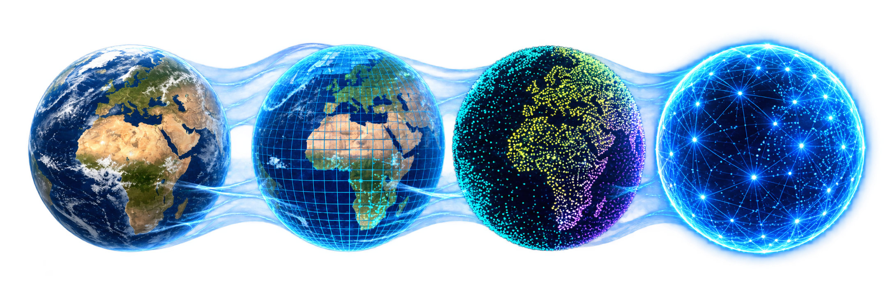
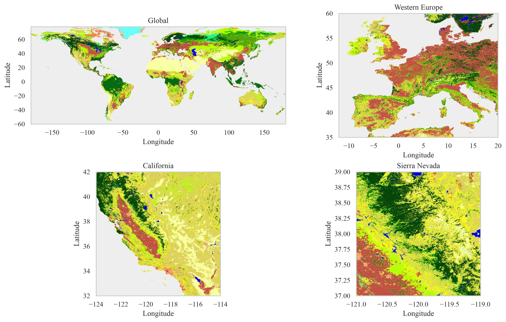
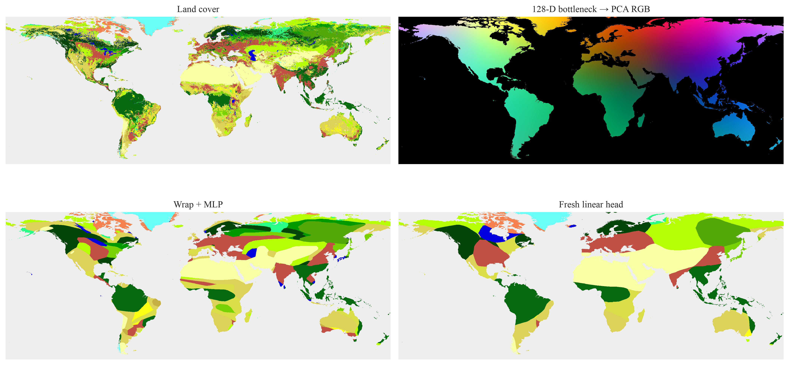

<p align="center">
  <a href="https://neuralearthfields.github.io/">
    
  </a>
</p>

<h1 align="center">Neural Earth Fields</h1>
<p align="center">Learning continuous representations of our planet.</p>
<p align="center"><a href="https://neuralearthfields.github.io/">Benchmark &amp; Hackathon</a> · Starter notebooks</p>

Train a [Wrap encoder](https://github.com/MarcCoru/locationencoder/blob/main/locationencoder/pe/wrap.py) and MLP to predict global land cover from longitude and latitude.

[](https://colab.research.google.com/github/neuralearthfields/neuralearthfields-starter/blob/main/starter.ipynb)

## Get started

```sh
uv sync
uv run jupyter lab starter.ipynb
```

[starter.ipynb](starter.ipynb) downloads the full [land-cover COG](https://huggingface.co/datasets/taylor-geospatial/neural-earth-fields-hackathon), samples land and lakes globally, and trains the model. It includes learning curves, a linear probe, and PCA RGB plots. Ocean and invalid labels are excluded.



*The source land-cover map at four scales.*

## Bottleneck embeddings



*One trained model: 128-dimensional bottleneck embeddings shown as PCA RGB, with land-cover reconstructions from the MLP and a fresh linear probe.*

Defaults are `Wrap (4) → 256 → 128 → 256 → 31`, with batch size 4,096. The middle 128 features are the embeddings. Edit the configuration cell to change capacity, training length, or sampling. Wrap learns broad patterns but misses local boundaries.

## Export rasters

[inference.ipynb](inference.ipynb) exports float32 embedding and uint8 prediction COGs from `outputs/model.pt`. Set the output directory and enable `write_global_cogs` to export the full grid. The 128-band embeddings need about 31.5 TB before compression, plus temporary files and overviews. The source grid is nominally 100 m in EPSG:4326; ground spacing varies with latitude.

Python 3.12–3.14. Use `.venv/bin/python` in your editor and `uv add PACKAGE` for dependencies. Plotting helpers live in `plot.py`.

Dataset by Demuzere, He, Martilli, and Zonato (2023), [Zenodo](https://zenodo.org/records/7670653), [CC BY 4.0](https://creativecommons.org/licenses/by/4.0/).
